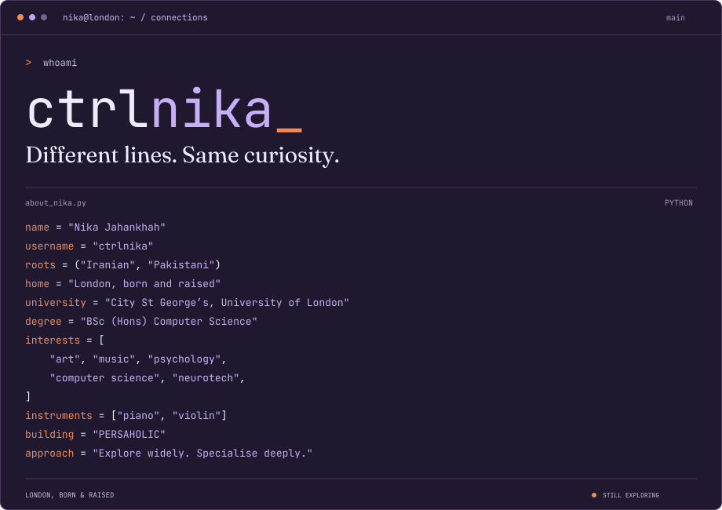

<picture>
  
</picture>

## A little context

Born and raised in London, with Iranian and Pakistani roots. My interests range from art and music to computer science, psychology and neurotech. I like exploring widely and going deep into the things that stay with me.

I’m building [PERSAHOLIC](https://persaholic.com), a home for my love of culture, memory and contemporary design. Elsewhere, I’m exploring bioinformatics and safer AI.

[Explore my portfolio](https://jahankhah.com) · [Visit PERSAHOLIC](https://persaholic.com) · [Let’s talk](mailto:nika@hamid.com)

## A few stops along the way

| [Stalled London](https://stalledlondon.lovable.app) | [Neural Nets](https://v0-neuralnets.vercel.app) | [Parachute](https://parachute2.lovable.app) |
| --- | --- | --- |
| Making London’s stalled housing developments visible. | Exploring neurotech, BCIs and bioinformatics. | An AI safety gateway. Work in progress. |

```python
# away from the keyboard
weekend = ["kayaking", "weightlifting", "more music"]
leg_press_kg = 120  # unfinished business
```

<details>
<summary>Read about_nika.py as text</summary>

```python
name = "Nika Jahankhah"
username = "ctrlnika"
roots = ("Iranian", "Pakistani")
home = "London, born and raised"
interests = [
    "art", "music", "psychology",
    "computer science", "neurotech",
]
instruments = ["piano", "violin"]
building = "PERSAHOLIC"
approach = "Explore widely. Specialise deeply."
```

</details>
