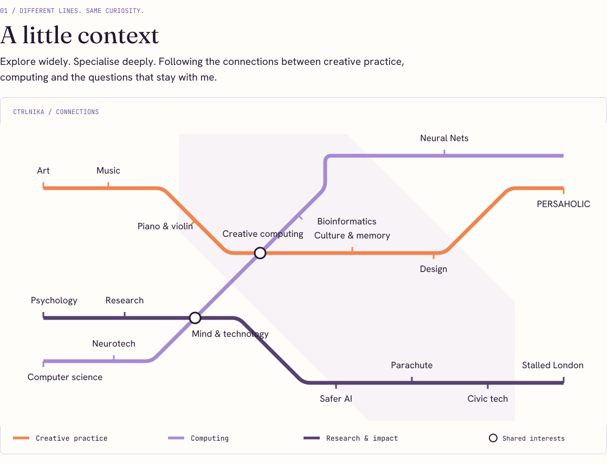
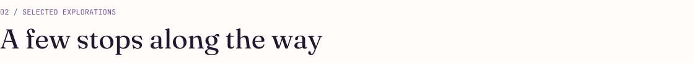
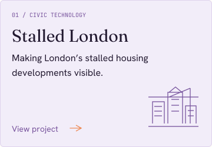
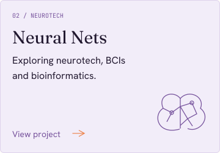
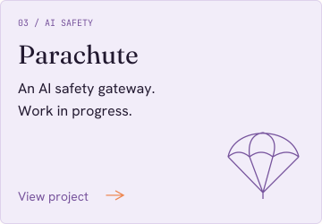
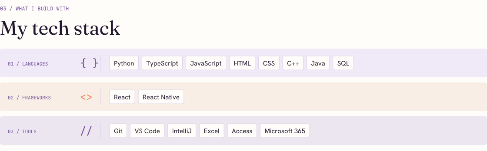

<picture>
  
</picture>



[Explore my portfolio](https://jahankhah.com) · [Visit PERSAHOLIC](https://persaholic.com) · [LinkedIn](https://www.linkedin.com/in/nikahamid) · [Let’s talk](mailto:nika@hamid.com)



<p>
  <a href="https://stalledlondon.lovable.app"></a>
  <a href="https://v0-neuralnets.vercel.app"></a>
  <a href="https://parachute2.lovable.app"></a>
</p>



<details>
<summary>Read about_nika.py as text</summary>

```python
name = "Nika Jahankhah"
username = "ctrlnika"
roots = ("Iranian", "Pakistani")
home = "London, born and raised"
university = "City St George’s, University of London"
degree = "BSc (Hons) Computer Science"
interests = [
    "art", "music", "psychology",
    "computer science", "neurotech",
]
instruments = ["piano", "violin"]
building = "PERSAHOLIC"
approach = "Explore widely. Specialise deeply."
```

### Connections

- **Creative practice:** art → music → piano and violin → culture and memory → design → [PERSAHOLIC](https://persaholic.com).
- **Computing:** computer science → neurotech → bioinformatics → [Neural Nets](https://v0-neuralnets.vercel.app).
- **Research and impact:** psychology → research → safer AI → [Parachute](https://parachute2.lovable.app) → civic technology → [Stalled London](https://stalledlondon.lovable.app).
- **Shared interests:** creative computing; mind and technology.

### Tech stack

- **Languages:** Python, TypeScript, JavaScript, HTML, CSS, C++, Java, SQL.
- **Frameworks:** React, React Native.
- **Tools:** Git, Visual Studio Code, IntelliJ, Excel, Access, Microsoft 365.

</details>
